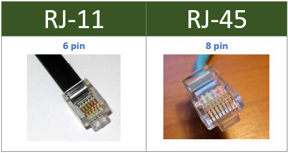
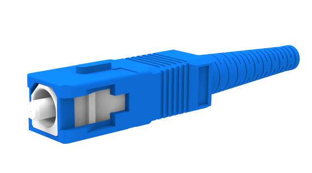
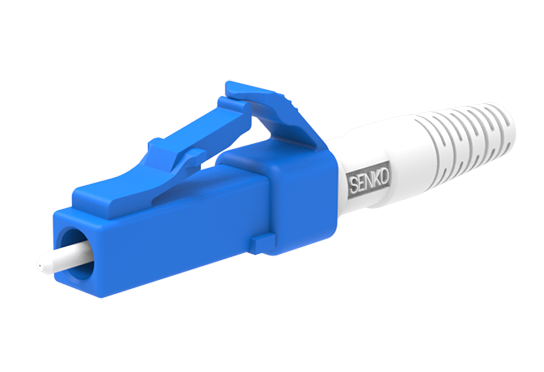
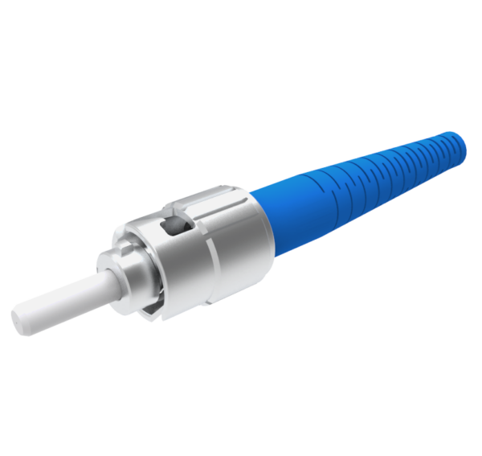
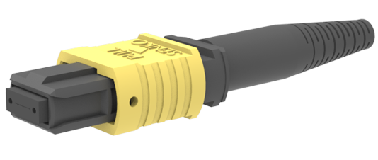
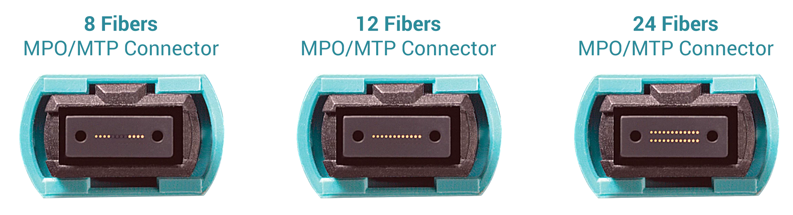
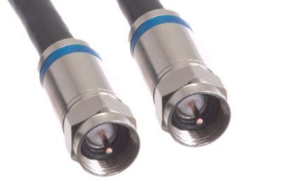
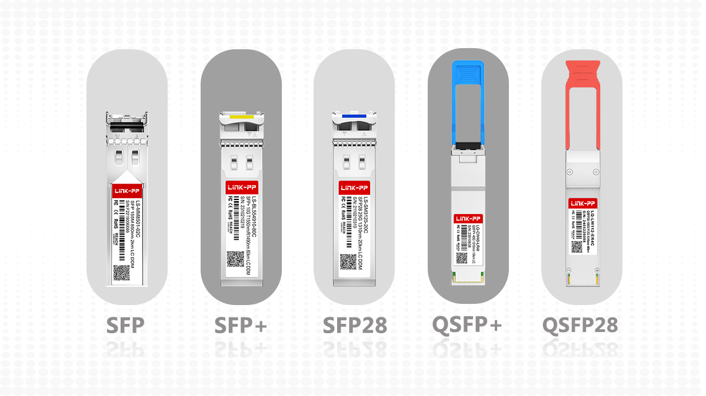

# 802.3 (Ethernet)
Comptia objective: Compare and contrast transmission media and transceivers.

|Ethernet Standard|Cable Category|Max Distance|Max Data Rate|
|---|---|---|---|
|1000BASE-T|Cat 5|100m|100Mbps|
|1000BASE-T|Cat 5e|100m|1Gbps|
|10GBASE-T|Cat 6|100m|1Gbps, 10Gbps up to 55m|
|10GBASE-T|Cat 6a|100m|10Gbps|
|10GBASE-T|Cat 7|100m|10Gbps|
|40GBASE-T|Cat 7a|100m|10Gbps, 40Gbps up to 50m|
|40GBASE-T|Cat 8|30m|25Gbps (8.1), 40Gbps (8.2)|

IEEE Ethernet Standards
- Speed, signal, media
- 1000BASE-T = 1000Mbps (1 Gbps), Baseband, Twisted Pair cable

|Speed|Max Data Rate||Acronym|Media Type|
|---|---|---|---|---|  
|10|10Mbps| |Any #|Coax|
|100|100Mbps||T|Twisted Pair|
|1000|1000Mbps (1Gbps)||S(Short)|Multi-mode Fiber|
|10G|10Gbps||L(Long)/E(Extended)|Single-mode Fiber|
|40G|40Gbps||||

EXAMPLES:
- 10BASE-2 = 10Mbps, Baseband, Coax
- 1000BROAD-T = 1000Mbps, Broadband, Twisted Pair
- 10BASE-SR = 10Gbps, Baseband, Multi-mode Fiber
- 10BASE-ER = 10Gbps, Baseband, Single-mode Fiber

### Connector Types
- RJ11 (Registered Jack)  
  Standard telephone interface
- RJ45  
  Standard ethernet interface  
  

# Fiber 
- Fiber  
Uses light to transmit data, offering significantly higher speeds and greater bandwidth over longer distances than traditional copper cables. Designed as either single-mode or multi-mode

- Single-mode Fiber  
Designed for long distance communication, using a single strand of glass fiber with a smaller diameter that allows only one mode of light.  
Minimizes attenuation and dispersion over distances without the need for repeaters  
Commonly used in telecommunications and cable TV networks

- Multi-mode Fiber  
Cable uses larger diameter fibers that allow multiple modes of light to propagate simultaneously  
More affordable and easier to work with compared to single-mode fiber, making them a popular choice for LANs and other short range applications  
Maximum supported distance of ~2km

### Connector Types
- SC (Subscriber/Square Connector)  
  Fiber connector with a push-pull latching mechanism, ensuring a secure connection  
  Square shaped design  
  Widely used in single mode fibers for telecommunications, CATV, and network applications  
  
- LC (Local Connector)  
  Small form factor fiber connector used for single and multimode fiber  
  Compact, square design with a push-pull latching mechanism  
  Widely used in telecommunications and data communications for high density connectivity and ease of use, especially in environments where space is limited  
  
- ST (Straight Tip)  
  Fiber connector with a bayonet locking mechanism, designed for quick and secure connections  
  Commonly used in multimode fiber networks. Such as campuses, LANs, and security systems
   
- MPO (Multi-fiber Push On)  
  Fiber connector designed for high density applications, capable of connecting multiple fibers (usually 12 or 24) in a single connector  
  Commonly used in data centers and telecommunications to facilitate rapid deployment and high bandwidth  
  Enables efficient, scalable fiber that allows high speed transmissions
   
   

# Other Standards
- Coax  
Type of cable consisting of a central conductor, insulating layer, metallic shield, and plastic jacket.  
Used for transmitting TV, satellite, and broadband internet signals  
Thicker and better shielding makes it less susceptible to interference and attenuation, ideal for high frequency applications like cable TV or internet services

- Twinax  
Consists of two inner conductors surrounded by a common shielding  
Used mainly in short range, high speed differential signaling applications  
Offers cost effective solution for high speed transmissions with lower latency and better noise immunity than TP copper cabling

- DAC (Direct Attach Copper)  
Used for short range connections between networking equipment.  
Offers cost effective, low power alternative for close range connectivity

### Connector Types
- F-type  
  Screws onto male port of an RG-6 or RG-59 coax interface, ensuring a secure connection for transmitting video and audio  
  Commonly used in cable, satellite TV, broadband internet, and radio frequency applications  
  Low cost, simplicity, and effective shielding against interference  

# Transceivers
- Transceivers  
Devices that can both transmit and receive data  
Often used in networks to interface with cables of different types such as converting electrical signals to optical signals for fiber

- Media Converters  
Type of transceivers that converts data signals from one media to another. Enabling the integration of different network technologies  
Crucial for extending network distances, improving network flexibility and supporting diverse network environments

- Protocol  
Transceivers must support the network protocols used in network infrastructures such as ethernet or fiber channel.  
Using the correct transceiver protocol ensures reliable data transmission, minimizes errors, and supports desired network speed and performance

- Ethernet  
Widely used networking technology that governs how data is transmitted over LANs. Supports speeds from 10Mb-10Gb  
Uses a combo of twisted pair and fiber cables within a network, applying a method of network access known as CSMA/CD (Carrier Sense Multiple Access with Collision Detection)

- FC (Fiber Channel)  
A high speed network technology primarly used for transmitting data between computer devices at rates of 16Gbps or higher in SANs  
Known for reliability and speed, making it suitable for connecting servers to shared storage devices and transferring large volumes of data

### Form Factors
- SFP (Small Form Factor Pluggable)  
  A compact, hot pluggable network interface modual used for both telecommunication and data communication applications  
  Supports speeds up to 1Gbps and is used to connect a entwork device to fiber or copper cables  
  Allows for easy network upgrades and maintenance due to their plug and play capability
- SFP+  
  Upgraded version of SFP  
  Supports speeds up to 10Gbps  
  Used for high speed connections on switches, routers, and other networking equipment  
  Provides a cost effective method of achieving 10Gbps
- QSFP (Quad SFP)  
  Capable of supporting 4x the bandwidth of SFP+ (40Gbps)  
  Commonly used in data centers and high performance computing environments for high density applications
- QSFP+  
  Upgraded version of QSFP  
  Supports speeds up to 40Gbps or more  
  Suitable for high speed data transmission in cloud computing, data centers, and high performance computing applications  

# Other Terminology
- Plenum Rating
- Transceivers
- Media converters

