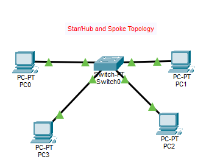
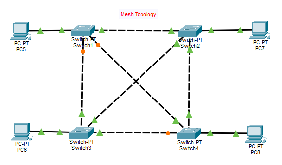
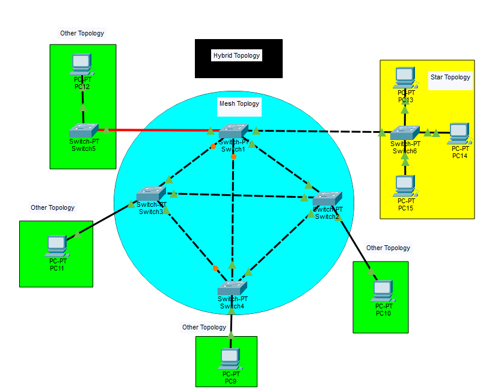
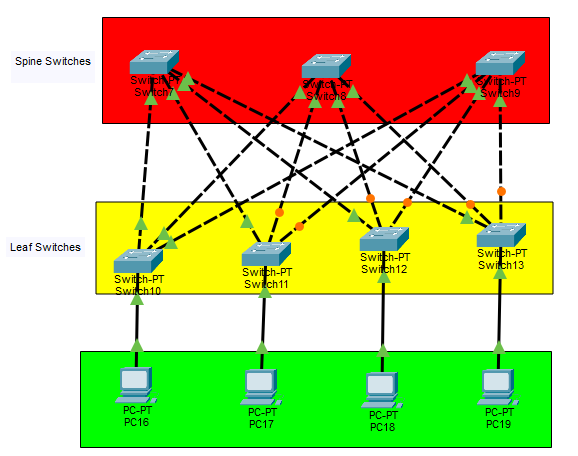
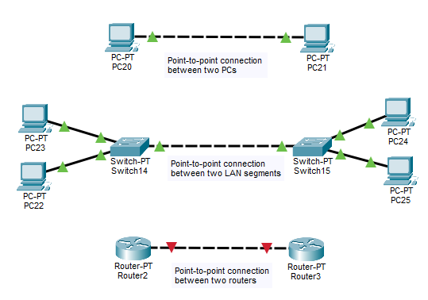
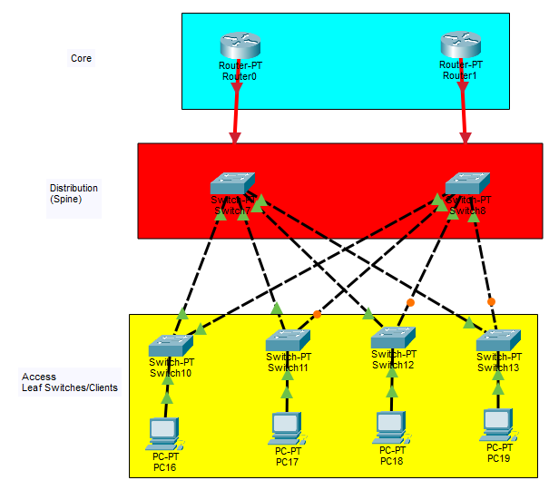
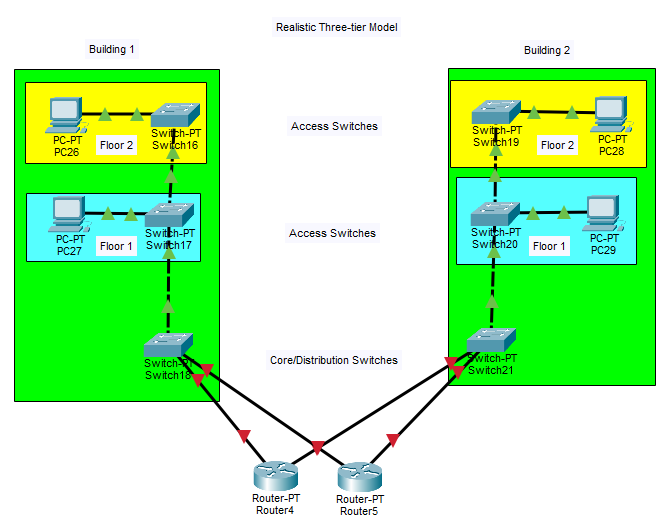

# Network Topologies
Comptia objective: Compare and contrast network topologies, architectures, and types.

- Star/Hub and Spoke  
All nodes are connected to a central node/hub  
Simplifies network management and troubleshooting but creates a single point of failure  
Widely used in LAN environments due to simplicity and ease of setup  

- Mesh  
Network setup where each node connects to an arbitrary number of other nodes creating a network with no central connection point  
Ensures high availability and redundancy. Because if one link fails, data can be rerouted through multiple paths  
Commonly used for high availability, redundancy, and load balancing

- Hybrid  
Combines two or more topologies  
Offers flexibility in network designs and can be tailored to meet specific needs or constraints of an organization  
Scalable and adaptable, suitable for large networks or complex needs

- Spine and Leaf  
Two layer topology. Each leaf switch (access layer) connects to each spine switch (distribution/core layer). However, leaf switches do no connect to each other, as do spines  
Leaf switches form the access layer where devices are connected, while spines serve as the backbone for data transport, connecting all leaf switches without interconnecting  
Favored in modern data centers and cloud computing, where rapid and reliable data access and network redundancy is crucial

- Point to Point  
Topology involves a direct connection between two networking devices  
Used for dedicated connections, such as those between a main office and a brand office, or between two networking equipment

## Three Tier Hierarchical Model
- Core  
  Backbone of the network, handles high speed packet switching across the network  
  Responsible for fast and reliable routing. Should have high redundancy and fault tolerance to prevent downtime

- Distribution  
  Acts as the intermediary between the core and access layers. Manages routing filtering and WAN access  
  Aggregates the data received from the access layer before it's transmitted to the core for routing to the final destination

- Access  
  The network's point of entry for devices and end users, connecting them to the network
  

- Collapsed Core Architecture  
Two tier model that merges the distribution and core layers  
Facilitates easier management and maintenance, while enhancing performance by reducing latency between the network's core and distribution functions  
Ideal for small and medium networks where managing separate layers is unnecessary

- Nort-South Traffic  
  Describes traffic flow between the data center and outside world. Focuses on inbound and outbound traffic

- East-West Traffic  
  Describes traffic flow with the same data center
