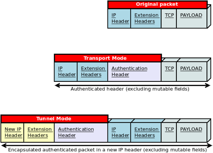

1.3 - Ports and Protocols
Comptia objective: Explain common networking ports, protocols, services, and traffic types.

|20/21  -FTP      |67/68  -DHCP |445   -SMB     |110  -POP3     |
|---|:---:|:---:|:---|
|22     -SFTP     |69     -TFTP |514   -Syslog  |995  -POP3(TLS)|
|22     -SSH      |80     -HTTP |636   -LDAPS   |143  -IMAP     |
|23     -Telnet   |123    -NTP  |1433  -SQL     |993  -IMAP(TLS)|
|25     -SMTP     |161/162-SNMP |3389  -RDP     |1521 -SQLNet   |
|587    -SMTP(TLS)|389    -LDAP |5060  -SIP     |3306 -MySQL    |
|53     -DNS      |443    -HTTPS|5061  -SIP(TLS)|               |

*See Ports page for additional info on specific ports/protocols

ICMP (Internet Control Message Protocol)
Used for sending diagnostic or control messages between network devices
Utilized for error reporting and diagnostics, such as unreachable hosts or netowrk segments, and for operational queries like echo requests and replies
Operates directly on top of IP, providing feedback about issues in the communication environment without carrying app data

TCP (Transmission Control Protocol)
Connection based protocol
Ensures data packets are transmitted in sequence and without errors, using acknowledgements, retransmissions, and flow control
Used for apps where data integrity and delivery assurance are crucial
SYN > SYN, ACK > ACK > Data Transfer

UDP (User Datagram Protocol)
Connectionless protocol that allows the transmission of data without establishing a prior connection between sending and recieving hosts
Provides a fast but "less reliable" method of communication, as it doesn't gaurantee packet deliver, order or error checking
Suitable for apps that require speed and efficiency over reliabilty, such as streaming audio, video, or games

GRE (Generic Routing Encapsulation)
A tunneling protocol developed by Cisco that encapsulates a variety of Network layer protocol packet types inside IP tunnels
Commonly used for VPNS and carrying network protocols across networks that don't natively support them
(allows us to encasulate our privately-addresses traffic as the payload in a publicly-addressed frame. This is one method of creating a VPN, however a GRE tunnel does not necessarily extend a private network)
(GRE does NOT provide encryption/security like IPSEC. It simply allows us to encapsulate/package protocols together)

IPSec (IP Security)
A suite of protocols designed to secure IP communication by authorizing and encrypting each IP packet in a data stream
Operates in two modes:
  Transport mode - encrypts the payload of each packet but leaves the IP header untouched
  Tunnel mode - Encrypts both the header and payload. Used for VPN connections

AH/ESP Example Source:https://www.redhat.com/en/blog/ipv6-packets-and-ipsec
AH (Authentication Header)
A component of IPSec used for providing connectionless integrity and data origin authorization for IP packets and proection against replay attacks
*INSERT AH EXAMPLE PICTURE HERE

Inline-style: 

ESP
