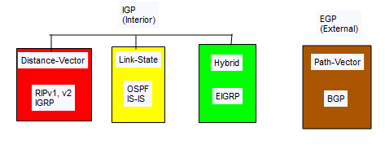

# 2.1 - Routing
Comptia objective: Explain characteristics of routing technologies.

- Routing  
  The process of selecting paths in a network a long which to send network traffic
- Static Routing  
  Involves manually configuring routers with specific paths to reach destinations  
  Simple to implement, lacks flexibility and scalability, does not automatically adjust to network changes
- Dynamic Routing  
  Automatically adjusts paths used to send data through the network. Routers communicate with each other using dynamic routing protocols, sharing info about network topologies and traffic conditions  
  Allows the network to adapt to changes such as link failures or congestion. Ensuring data takes the most effective route

## Dynamic Routing Protocols
- Distance Vector Protocols (RIP, IGRP)  
  Routers calculate the best path based on distance/hops  
  Shares routing tables with neighbors, simple setup, slow convergence
  * RIP (Routing Information Protocol)  
    A mostly depreciated/legacy routing protocol that may still be used in smaller networks.  
    Checks for network changes every 30 seconds by default, consuming a lot of unnecessary bandwidth and resources  
    Maximum hop count of 15
  * IGRP (Interior Gateway Routing Protocol)  
    Cisco proprietary distance vector protocol to overcome RIP's 15 hop limitation  
    Supports multiple metrics for each route, including bandwidth, delay, load, and reliability  
    Maximum configurable hop count of IGRP-routed packets is 255 (default 100), and routing updates are broadcast every 90 seconds (by default)
- Link State Protocols (OSPF, IS-IS)  
  Routers calculate the best path based on the shortest path using a map of the entire network topology  
  Each router maintains a complete topology map, sends updates when network changes, quick convergence
  * OSPF (Open Shortest Path First)  
    A link state protocol that uses the shortest path first  
    Every router keeps a full network topology map, routers send updates when network changes, calculates paths using bandwidth > hop counts
  * IS-IS (Intermediate System to Intermediate System)  
    Best utilized in extremely large networks.  
    IS-IS behaves similarly to OSPF/other link state protocols but uses a more advanced algorithm to calculate the shortest path through the network (Dijkstra's algorithm) 
- Hybrid Protocols (EIGRP)  
  * EIGRP (Enhanced Interior Gateway Routing Protocol)   
    Cisco proprietary advanced distance vector routing protocol that uses bandwidth, delay, link reliability, and load to calculate the best path (admin distance)  
    Extremely fast convergence, partial topology updates, and load balancing
- Path Vector Protocols (BGP)  
  Similar to distance vector protocols. But makes decisions based on paths, policies, and rules rather than just distance/cost  
  Shares the entire sequence of AS's (Autonomous Systems) a route traverses
  * BGP (Border Gateway Protocol)  
    The protocol underlying the global routing system of the internet. Used for routing data between autonomous systems
    

Helpful guide to compare routing protocols:  
https://info.pivitglobal.com/resources/interior-routing-protocols-comparison-rip-vs-eigrp-vs-ospf-vs-is-is

## Route Selection
- Route Selection  
  A critical process that determines the best path for data to travel from source to destination  
  Uses specific criteria such as administrative distance, prefix length, and metrics to choose the most efficient route
- Administrative Distance  
  A metric used by routers to rank the trust worthiness of routes received from different routing protocols
- Prefix Length  
  Specifies the number of contiguous bits of the network mask set to 1. Effectively devices the IP address into a network portion and host portion  
  Prefix length is denoted by a slash followed by a number (e.g. 192.168.1.0/24)  
  Integral part of CIDR
- Metric  
  A value associated with routes. Used by routing protocols to evaluate the cost of path traversal  
  LOWER METRIC = MORE DESIRABLE ROUTE  
  Different routing protocols may use various factors, such as bandwidth, delay, hop count, or even custom metrics to calculate this metric

## Address Translation
- NAT (Network Address Translation)  
  A method used to modify network address info in IP packet headers while in transit across a traffic routing device. Typically for the purpose of remapping one IP address space to another  
  Allows multiple devices on a private network to access the internet using a single public IP. Enhancing security by hiding internal IPs from the external network
- PAT (Port Address Translation)  
  A type of NAT that allows multiple devices on a local network to be mapped to a single public IP but with different port numbers for each session  
  Enables multiple connections from different devices to be distinguished from one another using a single public IP. Significantly increasing the scalability of NAT by allowing thousands of simultaneous connections through a few public IPs

## Other Terminology
- VRRP (Virtual Router Redundancy Protocol)  
  Allows for auto-assignment of available routers to participating hosts. Ensuring continuous availability even if one fails
- FHRP (First Hop Redundancy Protocol)  
  A general term for protocols like VRRP that provide the ability to automatically failover to a backup router in case of a primary router failure, minimizing downtime and maintaining network resiliency
- VIP (Virtual IP)  
  An IP not tied to a specific physical network interface on a device  
  Used to provide redundancy and load balancing for services hosted on multiple servers. Allowing multiple servers to share an IP  
  Commonly used in network load balancers and failover configs to ensure availability and scalability of critical applications and services
- Subinterface  
  A virtual interface created by dividing a single interface into multiple logical interfaces  
  Commonly used in scenarios where multiple VLANs exist on a single router or switch interface to manage traffic segregation and support various services or protocols over a single physical link  
  Subinterfaces are treated like separate interfaces, allowing for individual config settings such as IP, access control policies, or routing configs  
  Enhances network flexibility and efficiency, enabling more detailed traffic management and security enforcement without requiring additional hardware
