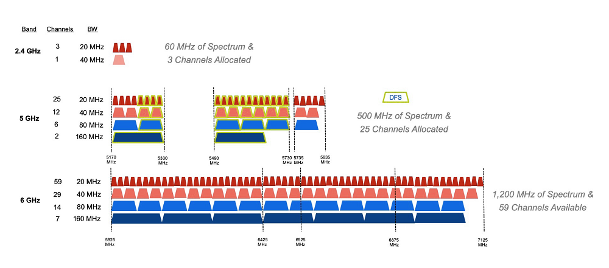

# 2.3 - Wireless Technology
Comptia objective: Given a scenario, select and configure wireless devices and technologies.

|WiFi #|Name|Frequency|Max Rate|Anagram|
|---|---|---|---|---|
|1|802.11A|5 GHz|54 Mb|"A" A beginning|
|2|802.11B|2.4 GHz|11 Mb|"B" Better range|
|3|802.11G|2.4 GHz|54 Mb|"G" Getting better throughput|
|4|802.11N|2.4/5 GHz|600 Mb|"N/AND" 2.4 AND 5 GHz|
|5|802.11AC|5 GHz|3.5 Gb|"A" A = 5 GHz|
|6|802.11AX|2.4/5 GHz|9.6 Gb|"X = 10" 10 Gb throughput|
|6e|802.11AX|2.4/5/6 GHz|9.6 Gb||

## Channels
- Channels  
  Subdivisions of the frequency bands used for wireless communications. Allowing multiple networks to operate simultaneously without interference  
  The availability and allowed channels can vary by country, subject to regulatory impacts that dictate specific channels and power levels that can be used
- Channel Width  
  Refers to the frequency span of a wireless channel  
  Wider channels = Increased bandwidth, in exchange for increased interference in congested areas
- Non-overlapping Channels  
  Channels that do NOT interfere with each other are crucial in environments with multiple wireless APs  
  In 2.4 GHz networks, channels 1, 6, and 11 are preferred because they do not overlap

 

- Regulatory Impacts  
  Refers to the rules and regulations set by government or international bodies that govern the use of wireless frequencies and channels to prevent interference between communication systems
- 802.11h  
  A standard to enhance 802.11a by adding DFS and TPC to comply with European regulations for 5 GHz WLANs
  * DFS (Dynamic Frequency Selection)  
    Designed to prevent EMI (electromagnetic interference) by avoiding channel operations with systems that predated WiFi such as military radar, satellite communication, and weather radar
  * TPC (Transmit Power Control)  
    Helps dynamically optimize power control to RF antennas to maximize the RF coverage within an environment without causing co-channel interference
## Frequency Options
- 2.4 GHz  
  Widely used for wireless networking, offering good balance between range and bandwidth  
  Long range, better penetration through physical barriers  
  Slower throughput compared to 5 and 6 GHz  
  Higher rate of interference due to channel congestion
- 5 GHz  
  Provides faster data rates at shorter distances than 2.4 GHz. Less likely to experience interference from other household device  
  Short range, poor penetration through physical barriers  
  Faster throughput compared to 2.4 GHz  
  Low chance of interference
- 6 GHz  
  Expands the bandwidth for wireless networks, doubling the spectrum available compared to 5 GHz  
  Supports higher data rates, lower latency, and more simultaneously connections. Making it ideal for high demand applications and environments
- Band Steering  
  Auto detects wireless devices capable of dual band operations and steers them to the less congested 5 or 6 GHz bands  
  Helps balance network load, maximize throughput, and improve overall wireless performance by minimizing interference found in the 2.4 band
## Service Set ID
- BSS  
  A group of wireless devices operating under the same WAP
- BSSID  
  The MAC address of a WAP  
  (TIP: If you know the IP of a WAP, use the ARP command in command-line to find its MAC address)
- SSID  
  The WLAN's network name (typically found in the list of open networks)
- ESS  
  A group of WAPs acting together to form an extended WLAN
- ESSID  
  The WLAN's network name (SSID) that is shared across an ESS
## Network Types
- Point to Point Networks  
  Establishes a direct connection between two wireless devices  
  Commonly used for linking two locations in a WAN or providing a dedicated pathway for data transmission, ensuring consistent, and reliable connectivity  
  Used by ISPs or to connect towers/building from far distances
- Mesh Networks  
  Consists of nodes that connect directly and dynamically to as many other nodes as possible. This configuration creates multiple pathways for data to travel between points, enhancing reliability and redundancy  
  Self healing and scalable, ideal for large areas like smart cities and IoT applications
- Ad Hoc  
  aka IBSS (Independent Basic Service Set)  
  Nodes communicate directly without the use of a router, APs, or network servers. Suitable for temporary setups where quick deployment is necessary
- Infrastructure Networks  
  Relies on fixed routers or APs that manage traffic to and from devices
## Encryption
- Encryption  
  Converts data into a coded format that can only be accesses and read by devices with the correct decryption key

- WEP (Wired Equivalent Privacy)  
  **OUTDATED, INSECURE**  
  Uses short 64-128 bit static keys
- WPA (WiFi Protected Access)  
  **OUTDATED, INSECURE**  
  TKIP encryption, uses dynamic 256 bit keys  
  Created as a short term bridge to temporarily overcome security flaws in WEP
- WPA2  
  **Secure** encryption using AES (Advanced Encryption Standard)  
  Users authorize using PSK via CCMP (Counter/CBC-MAC Protocol). Including Message Integrity Checks with CBC-MAC
- WPA3  
  **Most secure**  
  Secure encryption using AES-GCMP (AES-Galois/Counter Mode Protocol)  
  Data confidentiality with AES and Message Integrity Check with GMAC (Galois Message Auth Code)  
  Users authorize using SAE (Simultaneous Auth of Equals)
## Authentication
- PSK and Enterprise Authorization
- Guest Networks
- Captive Portals
- WPS
## Access Points
- Autonomous AP
- Lightweight AP
- WLC
- Autonomous vs Lightweight APs
## Antennas
- Directional
- Omnidirectional
